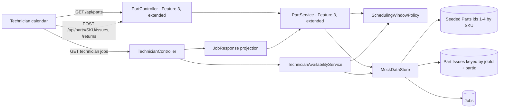

# ADR: Job-Linked, Time-Derived Parts Reservations

| Field | Value |
|---|---|
| **Status** | Proposed |
| **Date** | 2026-09-29 |
| **Requirements** | `requirements.md` |
| **Revision** | 2026-09-29 — revised in place for the requirements change that replaces the `P001`–`P004` catalog with Feature 3's SKU catalog (`Part` ids `1`–`4`: `CMP-CLUTCH`, `FLT-16`, `BRK-20A`, `VLV-BALL-075`). Adds decisions on the external part identifier, extending Feature 3's `Part` model, and reconciling Feature 3's `GET /api/parts`. Reservation model (Option 3), derived windows, shared scheduling policy, `Clock` injection, locking, and error mapping are unchanged. Originally proposed 2026-09-22. |

## Context

Feature 2 adds stock quantities to a fixed, seeded parts catalog and allows a technician to issue part quantities against one of their booked jobs. Issued quantities affect shared stock during the job's travel-buffered time window, can be returned early, must move when the job is rebooked, and must appear both in current inventory counts and in each job row as `<SKU>(qty)` entries.

ServiceForge currently uses Java 17, Spring Boot 3, Angular, and a singleton in-memory `MockDataStore`. The code has changed since this ADR was first written; the current state relevant to this feature is:

- `Job` owns the technician identity, final `startTime`/`endTime` (`LocalDateTime`), mutable `status`, and — since Feature 3 — a final, nullable `requiredSkill`. There is no job-update operation.
- `Technician` carries a `skills` list (Feature 3).
- Feature 3 introduced `model/Part` with `Long id` (final), `String sku`, `String name`, a `(Long, String, String)` constructor, and setters for `sku`/`name`. `MockDataStore` seeds exactly four parts — `1 CMP-CLUTCH` (AC Compressor Clutch), `2 FLT-16` (16x25x1 Air Filter), `3 BRK-20A` (20A Single-Pole Circuit Breaker), `4 VLV-BALL-075` (3/4in Brass Ball Valve) — and exposes `getAllParts()` and `findPartBySku(String)`.
- Feature 3 also added a read-only `GET /api/parts` (`PartController` → `PartService` → `MockDataStore.getAllParts()`) that serializes `Part` directly as `{id, sku, name}`.
- Controllers serialize `Technician` and `Job` model objects directly; the only DTOs are `BookJobRequest` and `ApiError`.
- `TechnicianAvailabilityService.TRAVEL_BUFFER_MINUTES` is a public constant of 45, applied by the active overlap rule, and read directly by `Feature3DispatchControllerTest`.
- The Angular app has `Technician` and `Job` models (with optional Feature 3 fields) and a `TechnicianService`; there is no Angular part model or parts service.

The project requires constructor injection, service-owned business logic, `ResponseEntity` controller responses, and Angular HTTP calls through services.

The main design problem is that inventory has two views of the same source data:

- current availability, which depends on the observation time; and
- parts allocated to a job, which persists before, during, and after the active hold until returned.

Persisting `available` or copied hold timestamps would let those views drift when time advances or a job is rebooked.

A second problem, introduced by the 2026-09-29 requirements revision, is that the catalog, its model, and a read endpoint already exist from Feature 3. Feature 2 must extend them rather than create a parallel catalog, without breaking Feature 3's model, seed, and REST tests.

## Decision Drivers

- Preserve `available + inUse = total` and prevent negative quantities.
- Reject an issue atomically when shared stock is insufficient anywhere in its job window.
- Derive hold timing from the linked job and the same 45-minute policy used by scheduling.
- Job rescheduling is out of scope for Feature 2; hold windows are derived from job times when evaluated, but no rebooking behavior is implemented or tested for this feature.
- Keep the availability table and `Parts Used` column backed by one source of truth.
- Make time-boundary behavior deterministic and testable.
- Fit the existing in-memory, package-by-layer architecture without adding a database.
- Extend Feature 3's `Part` model and `GET /api/parts` additively so there is one catalog and Feature 3's tests stay green.
- Show and reference parts by SKU, and order them by numeric `id` (seed order), as the revised requirements state.

## Constraints

- The catalog is exactly the four parts Feature 3 already seeds in `MockDataStore` — ids `1`–`4` with SKUs `CMP-CLUTCH`, `FLT-16`, `BRK-20A`, `VLV-BALL-075` — each gaining a fixed total quantity at startup. Runtime catalog administration is out of scope.
- Feature 3 compatibility: the `Part(Long, String, String)` constructor, `getId`/`getSku`/`getName`, and `setSku`/`setName` stay; `GET /api/parts` keeps returning `id`, `sku`, and `name` for every part; job JSON keeps `requiredSkill` (present with `null` when absent); `Technician.skills` is untouched; `TechnicianAvailabilityService.TRAVEL_BUFFER_MINUTES` stays publicly readable as 45.
- Feature 3's spec put parts stock, job linkage, parts write endpoints, and Angular parts UI out of scope *for Feature 3*. Feature 2's revised requirements explicitly take on those capabilities by extending Feature 3's model and endpoint; no Feature 3 behavior is removed.
- Parts and issue records remain in memory and reset on restart.
- An issue belongs to exactly one part, job, and technician; the job must belong to that technician.
- Issue and return quantities are positive integers. No partial issue fulfillment is allowed.
- Inventory is shared across technicians.
- The 45-minute value must have one authoritative definition.
- The active no-overlap booking rule remains applicable to job scheduling; this feature must not weaken it.
- Existing REST error conventions use `ApiError`; validation errors should be `400`, missing resources `404`, and stock/state conflicts `409`.

## Considered Options

### Option 1: Store mutable available and in-use counters

Each `Part` stores `total`, `available`, and `inUse`. Timers or request-time reconciliation move quantities between counters at hold boundaries.

#### Benefits

- Listing inventory is a simple read.
- The model resembles the columns shown in the UI.

#### Costs and Risks

- Counters become stale as wall-clock time passes without a request or background scheduler.
- Rebooking requires finding and moving scheduled transitions.
- Multiple mutable counters can violate the reconciliation invariant.
- A scheduler adds lifecycle, race, and test complexity that is disproportionate for an in-memory application.

### Option 2: Store immutable reservation windows on issue records

Each issue copies the job start/end plus the buffer when it is created. Counts are derived from records active at the observation time.

#### Benefits

- No scheduler or mutable aggregate counters are required.
- Historical allocation windows remain explicit.

#### Costs and Risks

- Rebooking creates stale windows unless every job edit also updates issue records.
- The copied buffer and timestamps introduce duplicate sources of truth.
- Cross-service updates become necessary to preserve consistency.

### Option 3: Store job-linked issue quantities and derive windows and counts

Store fixed part totals and outstanding issue quantities keyed by part and job. At query or command time, resolve each issue's current job and derive its buffered window from the job timestamps and one shared scheduling policy. Inject a `Clock` into inventory logic so the current view is deterministic in tests.

#### Benefits

- Job edits automatically move holds because timestamps are never copied.
- Current counts cannot become stale merely because time advances.
- `PartIssue` is the single source for stock calculations and job display.
- Fixed totals plus derived counts make reconciliation straightforward.
- No background process or external infrastructure is required.

#### Costs and Risks

- Reads and issue validation scan in-memory jobs and issue records.
- Correct interval-capacity validation is more involved than checking current availability.
- Retaining completed allocations indefinitely would require a later history/cleanup policy.

### Option 4: Identify parts by SKU in REST paths

Command routes take the SKU (`/api/parts/{sku}/...`). The service resolves the SKU to a `Part` once at the boundary via the existing `MockDataStore.findPartBySku`, and all internal records store the numeric `Long` part id.

#### Benefits

- Matches the revised requirement that parts are "shown and referenced by SKU", and the `<SKU>(qty)` format in `Parts Used`, so a UI can act on what it displays without a second lookup.
- Reuses Feature 3's existing, tested `findPartBySku` lookup.
- The seeded SKUs contain only upper-case letters, digits, and hyphens, so they are URL-path-safe without encoding.
- Keeping `Long` ids internally means stored issues are not keyed by a field that has a setter.

#### Costs and Risks

- `Part.setSku` exists, so a SKU change would invalidate URLs a client has cached (stored issues survive because they use the numeric id). No runtime path calls `setSku` today.
- Case sensitivity has to be decided; the current lookup uses exact `equals`.

### Option 5: Identify parts by numeric id in REST paths

Command routes take the `Long` id (`/api/parts/{id}/...`), matching `/api/technicians/{id}`.

#### Benefits

- Immutable identifier, consistent with the other resource routes.
- No string matching or encoding concerns.

#### Costs and Risks

- Contradicts the requirement that parts are referenced by SKU; the id is only meant to define ordering.
- Clients that show `CMP-CLUTCH(2)` would need a separate SKU→id map to issue or return.
- Adds a `findPart(Long)` path at the API edge that duplicates the existing SKU lookup.

### Option 6: Add a fixed total quantity to Feature 3's `Part`

Add a final `int totalQuantity` to `Part` with a new `(Long, String, String, int)` constructor and `getTotalQuantity()`. The existing 3-arg constructor stays and delegates with a total of `0`. Seed the four existing parts with the 4-arg constructor.

#### Benefits

- One catalog, one model, as the requirements direct.
- Additive per the migration-safety skill: no field, constructor, getter, or setter is removed or renamed.
- The total sits next to the identity it describes, so seed data and projections read from one place.

#### Costs and Risks

- A `Part` built with the 3-arg constructor has a total of `0`, which is valid but would reject every issue. Only tests use that constructor after seeding changes.
- If `Part` were serialized directly, Jackson would add a `totalQuantity` key; this is avoided because `GET /api/parts` returns a projection DTO (Option 8).

### Option 7: Keep `Part` unchanged and store totals in a separate stock map

`MockDataStore` keeps `Map<Long, Integer> totalsByPartId` alongside Feature 3's `Part` list.

#### Benefits

- Zero change to the Feature 3 model class.

#### Costs and Risks

- Two structures must be seeded and kept in step for the same four parts; a missing map entry is a latent null/zero bug.
- Goes against the requirement to extend the existing `Part` model.

A separate Feature 2 parts catalog (the original `P001`–`P004` model) was also considered and is ruled out by the revised requirements.

### Option 8: Extend `GET /api/parts` to return an availability projection

`GET /api/parts` returns `PartAvailabilityResponse[]` with `id`, `sku`, `name`, `inUse`, `available`, and `total`, calculated at one observation instant and sorted by `id`. Command sub-resources are added under the same controller.

#### Benefits

- A strict superset of Feature 3's `{id, sku, name}` shape, so Feature 3's `GET /api/parts` test and any existing consumer keep working.
- One parts endpoint and one controller, as the requirements direct ("extends that model and endpoint").
- Keeps derived counts out of the domain model.

#### Costs and Risks

- The Feature 3 endpoint becomes clock-dependent; its payload is no longer a static catalog.
- The response type changes from `List<Part>` to a DTO list. This is compatible for JSON consumers but not for Java code that called `PartController.getAllParts()` expecting `Part`; there is none today.

### Option 9: Keep `GET /api/parts` as the catalog and add `GET /api/parts/availability`

#### Benefits

- Feature 3's endpoint and return type are untouched.

#### Costs and Risks

- Two parts read endpoints with overlapping data; the UI would need to join them or ignore one.
- Conflicts with the requirement to extend the existing endpoint rather than add a second view of the catalog.

## Decision

Adopt Option 3 for the reservation model, Option 4 for part identifiers, Option 6 for the total quantity, and Option 8 for `GET /api/parts`.

**Part model (Option 6).** Extend Feature 3's `Part` with a final `int totalQuantity`, a `(Long id, String sku, String name, int totalQuantity)` constructor, and `getTotalQuantity()`. Keep the `(Long, String, String)` constructor, which delegates with a total of `0`, and keep all existing getters and setters. Change the four existing `MockDataStore` seed lines to the 4-arg constructor with the same ids, SKUs, names, and order. Proposed seed totals: `CMP-CLUTCH` 3, `FLT-16` 10, `BRK-20A` 5, `VLV-BALL-075` 3. This meets "some seeded with a total of 3" and gives `CMP-CLUTCH` room for the Story 6 example of 2 units. The exact non-3 values are a seed choice, not a contract.

**Issue records (Option 3).** Add a mutable `PartIssue` holding its identity, `partId: Long` (the numeric `Part` id, never the SKU), `jobId`, `technicianId`, and positive `outstandingQuantity`. There is at most one outstanding `PartIssue` per `(jobId, partId)`: a repeated issue for the same job and part adds to the existing record after the capacity check, and a return reduces that record. This means each SKU appears at most once in `Parts Used`, and a return is never ambiguous. Records that reach zero outstanding quantity are removed. `MockDataStore` owns the four parts and all issue records and provides lookup and mutation operations.

**Shared policy.** Move the 45-minute value into one shared backend `SchedulingWindowPolicy`, used by both technician conflict detection and parts-window calculations. `SchedulingWindowPolicy.TRAVEL_BUFFER_MINUTES = 45` is the only literal. `TechnicianAvailabilityService.TRAVEL_BUFFER_MINUTES` stays as a public compile-time alias of it (`= SchedulingWindowPolicy.TRAVEL_BUFFER_MINUTES`), so the Feature 1 decision log reference and Feature 3's DoD 15 test keep resolving. A buffered job interval starts at `job.startTime - 45 minutes` and ends at `job.endTime + 45 minutes`.

Important boundary semantics (human decision applied): The policy exposes two explicit predicates so booking semantics remain unchanged while parts-hold semantics are inclusive for parts holds only:

- `SchedulingWindowPolicy.bookingContains(instant, job)` — the booking/conflict predicate, intentionally half-open (unchanged booking semantics from Feature 1 and existing tests).
- `SchedulingWindowPolicy.partsHoldContains(instant, job)` — the parts-hold predicate, intentionally inclusive at both ends for parts holds only (per the human decision). Booking behavior remains unchanged.

**Service ownership.** Extend Feature 3's existing `PartService` into the single parts service rather than adding a parallel `PartsInventoryService`, so that only one service reads the catalog. It gets `MockDataStore`, `SchedulingWindowPolicy`, and `Clock` by constructor injection, and owns issue, return, capacity, availability projection, and `Parts Used` formatting. Inventory list responses are projections calculated at the service's current instant; model objects do not store `available` or `inUse`.

**Capacity.** For a candidate issue, the service first checks the quantity, part (by SKU), technician, job, and job ownership, without mutating anything. It then computes the greatest quantity already reserved for the same part at any point in the candidate job's buffered interval. Because reservation intervals and quantities are piecewise constant, checking interval boundary events is sufficient. The request succeeds only when:

$$
\max_{t \in W_{candidate}} reserved(part,t) + requested \le total(part)
$$

The check and insertion/increment run under the data store's inventory lock, so concurrent requests cannot both see the same capacity and over-allocate it. Failed commands perform no mutation.

**Returns.** A return strictly means releasing quantity from an outstanding `(jobId, partId)` allocation. Returning more than is outstanding is `400` (bad request). Reducing to zero removes the issue record. If the issue is active at the current instant (using `SchedulingWindowPolicy.partsHoldContains`), the inventory projection changes immediately. If the issue is outside its active hold window, the current availability was already unaffected but future allocation is released for subsequent windows. The ADR follows the human decision: restock does not change a part's `total` and cannot be used to add warehouse inventory.

Issuing rules (human decision applied): Parts may only be issued against `SCHEDULED` jobs. Attempts to issue against a non-`SCHEDULED` job (for example `COMPLETED` or `CANCELLED`) must be rejected with `409 Conflict`. Parts held by a job are released immediately when the job becomes `COMPLETED` or `CANCELLED`.

**Part identifier (Option 4).** REST command paths identify parts by SKU using case-insensitive matching through a normalized lookup (for example, `findPartBySku(sku.toUpperCase(Locale.ROOT))`). The controller performs the boundary lookup (unknown SKU → `404`), and after that the service operates on the numeric `Long` id for stability.

**Endpoint reconciliation (Option 8).** Extend Feature 3's `PartController` in place. `GET /api/parts` returns `PartAvailabilityResponse[]`, an additive superset of Feature 3's `{id, sku, name}`, sorted by `id`. Add the issue and return sub-resources to the same controller.

**Job projection.** Add a `JobResponse` DTO for `GET /api/technicians/{id}/jobs` that keeps every field `Job` serializes today, including `requiredSkill` (always present, `null` when absent), and adds `partsUsed`. `partsUsed` is built from the same issue records: entries are `<SKU>(qty)` sorted by `Part.id` ascending (not by SKU), joined with `; `, with no trailing separator, and it is an empty string when there are none. Do not add issue collections to `Job`, because that would couple the scheduling model to mutable inventory state and create two ownership paths. `POST /api/jobs` keeps returning `Job` unchanged; a newly booked job has no issues.

## Architecture and Data Flow

Issue flow:

1. The UI submits the part SKU in the path and technician, job, and quantity in the body.
2. The controller validates request shape and delegates to `PartService`.
3. The service resolves the SKU to a `Part` (404 if unknown) and confirms the technician, job, and job ownership.
4. Under one inventory lock, it derives the candidate job window, calculates peak overlapping allocation for that part id, and either inserts/increments the `(jobId, partId)` issue or rejects without mutation.
5. The response returns the resulting allocation; the UI refreshes jobs and parts from their query endpoints.

Current inventory flow:

1. The service obtains `Clock.instant()` once for a consistent snapshot.
2. It resolves each outstanding issue against its current job times.
3. It sums quantities whose buffered windows contain the observation instant.
4. For each part, `available = total - inUse`; the result is sorted by part id.

`Parts Used` flow:

1. For each job in the response, the service collects its outstanding issues.
2. It sorts them by `Part.id` ascending, maps each to `<SKU>(outstandingQuantity)`, and joins with `; `.
3. No issues yields `""`.

## Interfaces and Data Model

Backend domain and policy:

- `Part { id: Long (final), sku: String, name: String, totalQuantity: int (final) }`. New constructor `Part(Long, String, String, int)` and `getTotalQuantity()`. The Feature 3 constructor `Part(Long, String, String)` stays and delegates with `totalQuantity = 0`. `setSku`/`setName` stay. There is no `setTotalQuantity`.
- `PartIssue { id: Long, partId: Long, jobId: Long, technicianId: Long, outstandingQuantity: int }`, unique on `(jobId, partId)`.
- `SchedulingWindowPolicy` owns `TRAVEL_BUFFER_MINUTES = 45` and derives buffered job windows. `TechnicianAvailabilityService.TRAVEL_BUFFER_MINUTES` becomes an alias of it.
- `MockDataStore` keeps `getAllParts()` and `findPartBySku(String)` and adds `findPart(Long)`, all-job lookup/`findJob(Long)`, issue lookup/listing by job and by part, issue id generation, and atomic inventory mutation support. Seeds switch to the 4-arg `Part` constructor with ids, SKUs, names, and order unchanged.

REST interfaces:

- `GET /api/parts` returns `PartAvailabilityResponse[]` with `id`, `sku`, `name`, `inUse`, `available`, and `total` at one observation instant, sorted by `id`. This is additive to Feature 3's `{id, sku, name}`.
- `POST /api/parts/{sku}/issues` accepts `{ technicianId, jobId, quantity }` and returns `201` with `PartIssueResponse { partId, sku, jobId, technicianId, outstandingQuantity }`.
- `POST /api/parts/{sku}/returns` accepts `{ technicianId, jobId, quantity }` and returns `200` with the same shape. `outstandingQuantity` is `0` when the return fully closes the allocation and the record is removed.
- `GET /api/technicians/{technicianId}/jobs` keeps its route and returns `JobResponse[]` with `id`, `technicianId`, `customerName`, `startTime`, `endTime`, `status`, `requiredSkill` (serialized as `null` when absent; no `NON_NULL` inclusion), and `partsUsed: string` (for example `CMP-CLUTCH(2); BRK-20A(1)`, sorted by part id, `""` when no outstanding issues).
- `POST /api/jobs` is unchanged.

Error mapping:

 - `400 ApiError`: non-positive quantity, return greater than outstanding, malformed request.
 - `403 ApiError`: wrong-owner — attempts to issue or return against a job owned by another technician.
 - `404 ApiError`: unknown SKU, missing technician, job, or `(jobId, partId)` allocation.
 - `409 ApiError`: insufficient stock for the candidate window, or illegal issue against a non-SCHEDULED job.

Frontend additions:

- New `part.model.ts` with `PartAvailability { id, sku, name, inUse, available, total }`, `PartIssueRequest`, and `PartIssueResponse`. Feature 3 added no Angular part model, so nothing is replaced.
- `Job` gains optional `partsUsed?: string`, so Feature 3's model spec literals still compile.
- A dedicated `PartsService` for parts HTTP operations, addressing commands by SKU (`encodeURIComponent` applied defensively). Components do not call `HttpClient` directly.
- The existing calendar component loads parts on initialization and refreshes both parts and jobs after successful issue/return operations.
- The existing jobs table adds `Parts Used`, rendering the backend string as-is. The parts table appears directly below the booking panel with exactly the four required columns, and `Part Name` renders `name`.

## Consequences

### Positive

- Time progression and job rebooking cannot leave stored availability or hold timestamps stale.
- Both UI views are reconciled from the same issue records.
- Capacity is enforced across all overlapping technicians' buffered job windows, not only at the current instant.
- An injected clock enables exact before, boundary, and after tests. Implementation and tests must adopt a Clock-in-UTC contract: production `Clock.systemUTC()`; tests override the `Clock` bean to a fixed UTC instant using `@TestConfiguration` providing a `@Primary Clock` or `@MockBean Clock`. Document this guidance in the implementation plan.
- Atomic command handling preserves all-or-nothing behavior in the singleton in-memory store.
- One parts catalog, model, service, and endpoint: Feature 3's artifacts are extended, not duplicated.
- SKU-addressed commands match what the UI and `Parts Used` display.

### Negative

- The service performs linear scans suitable for the seeded in-memory scope but not a large production inventory.
- Job query projection now depends on inventory data.
- Explicit locking is required because the existing mutable lists are not thread-safe. Guard both job-list reads and writes with the inventory lock (or make the job list a concurrent collection) so that scanning jobs to calculate windowed allocations and any job mutations cannot produce a ConcurrentModificationException. Update `MockDataStore`'s `save()`/write methods as part of implementation to acquire the same lock used for inventory mutation.
- The REST API exposes commands but the current requirements do not specify UI controls for issuing and returning parts.
- Feature 3's `GET /api/parts` becomes clock-dependent, and its Java return type changes from `List<Part>` to a DTO list (JSON-compatible).
- The `Part` 3-arg constructor now yields a part with total `0`, which silently rejects issues if used for real stock.

### Risks and Mitigations

- **Boundary ambiguity:** the requirements say both that stock is available starting exactly at the buffered end and that the buffered end instant is inclusive. Implement the explicit edge-case rule as inclusive pending confirmation, and pin it with tests; see Open Questions.
- **Shared constant drift:** centralize the buffer in `SchedulingWindowPolicy`, alias it from `TechnicianAvailabilityService`, and test both booking and inventory behavior against it.
- **Concurrent over-allocation:** perform capacity check and issue mutation under one lock and add a concurrency-focused service test. Test guidance: add a focused concurrency test that races two issue requests for the last available unit; assert exactly one succeeds (`201`) and the other fails with `409`, and validate the store state afterwards to ensure no over-allocation.
- **Inconsistent snapshots:** capture the clock once per list operation and project all rows from that instant.
- **Invalid orphan issues:** validate references before insertion and keep issue mutation APIs internal to the service/data layer.
- **Job API compatibility:** replace raw `Job` serialization on the technician jobs route with a `JobResponse` that keeps every existing field name, including `requiredSkill` with `null` serialized, and adds only `partsUsed`. Feature 3's DoD 9 test pins this.
- **Parts API compatibility:** `PartAvailabilityResponse` keeps `id`, `sku`, `name`; Feature 3's DoD 12 test pins this. Its `total` key is deliberately not named `totalQuantity`, because the model is not serialized directly.
- **Part model compatibility:** keep the 3-arg constructor and both setters; Feature 3's `Feature3ModelTest` pins this. Seed only through the 4-arg constructor so no seeded part has total `0`.
- **SKU mutability:** `Part.setSku` exists. Stored issues key on the immutable `Long` id, so a SKU change cannot orphan them; only the path lookup and rendered `Parts Used` text would follow the new SKU. No runtime path calls `setSku`.
- **Ordering regression:** `CMP-CLUTCH(2); BRK-20A(1)` is id order but not alphabetical order. Test with exactly that pair (and `FLT-16` before `BRK-20A`) so a sort-by-SKU regression fails.
- **Window vs current availability:** `GET /api/parts` reports availability for the current instant (`now`) using the injected UTC `Clock`. Issue capacity is evaluated as the peak reserved quantity over the candidate job's buffered window; therefore a `409` insufficiency can occur even though `GET /api/parts` shows sufficient `available` now. Controller error messages for `409` should include the candidate window and the maximum issuable quantity for transparency.

## Requirement Traceability

| Requirement | Architecture element | Verification point |
|---|---|---|
| Exactly four seeded parts (`CMP-CLUTCH`, `FLT-16`, `BRK-20A`, `VLV-BALL-075`) | Feature 3 `MockDataStore.seed` switched to 4-arg `Part` with `totalQuantity` | Fresh-context test checks exactly 4 parts, ids `1`–`4` with those SKUs in order, positive totals, and at least one total of 3 |
| Extend Feature 3 `Part` rather than a second catalog | Additive `totalQuantity` + 4-arg constructor; 3-arg constructor and setters retained | `Feature3ModelTest` and `MockDataStoreFeature3Test` pass unchanged |
| Live parts list | `GET /api/parts` (Feature 3 endpoint extended) returning clock-derived `PartAvailabilityResponse` | Controller test at fixed instants before, during, and after a hold; Feature 3 DoD 12 test still passes |
| Parts referenced by SKU | SKU path variable resolved via `findPartBySku`; `Long` id internally | Controller tests for known SKU success and unknown SKU `404` |
| Issue against owned job | `PartService.issue`, ownership validation | Service/controller tests for success, missing ids, and wrong technician |
| Shared stock and no partial issue | Peak interval capacity check under lock | Overlapping-window and unchanged-after-409 tests |
| Exact 45-minute linkage | Shared `SchedulingWindowPolicy`; `TechnicianAvailabilityService.TRAVEL_BUFFER_MINUTES` alias | Boundary tests, existing booking conflict tests, Feature 3 DoD 15 test |
| Rebooking moves hold | Resolve job timestamps at calculation time | Mutate/rebook job time and verify old/new window projections |
| Return/restock | Atomic reduction/removal of the `(jobId, partId)` `PartIssue` | Partial, full, excessive, inactive, and active return tests |
| Reconciliation invariant | Derived `inUse` and `available` from fixed total | Tests assert non-negative counts and sum equals total after command sequences |
| Parts availability panel | Angular `PartsService` and table below booking panel | Component HTTP/render tests for required columns and refreshed values |
| Per-job `Parts Used` as `<SKU>(qty)` joined by `; ` | `JobResponse.partsUsed` projection sorted by `Part.id` | Backend test for `CMP-CLUTCH(2); BRK-20A(1)` (id order, not alphabetical), blank, reduced, and removed; Angular render tests |
| Job response keeps Feature 3 fields | `JobResponse` preserves all `Job` fields incl. `requiredSkill` | Feature 3 DoD 9 test passes against `JobResponse` |

## Open Questions

1. At exactly `job.endTime + 45 minutes`, should the issue still be in use? The edge-case section says yes (inclusive), while Story 3 says the unit is available starting at that instant. This ADR provisionally follows the explicit edge-case rule; human approval should settle the contradiction before implementation.
2. The requirements mandate backend issue/return capability but only explicitly require the parts table and `Parts Used` column in the UI. Should issue and return controls be added to the technician screen, or are those commands API-only for Feature 2?
3. Job editing/rebooking is described as behavior the design must tolerate, but no edit endpoint currently exists. Is implementing job editing part of Feature 2, or should only the inventory design and tests prove that changed job timestamps are followed when such editing is introduced?
4. *(New, 2026-09-29)* Should SKU matching in `/api/parts/{sku}/...` be exact and case-sensitive? This ADR provisionally follows Feature 3's existing `findPartBySku` (`equals`), so `cmp-clutch` returns `404`.
5. *(New, 2026-09-29)* The requirements say parts are "shown" by SKU, but the panel's required columns are Part Name / In Use / Available / Total. Should the SKU be visible in the parts table (for example as `name (SKU)` or a fifth column)? This ADR provisionally renders exactly the four columns with `name`, and the payload includes `sku` so the answer changes only the template.
6. *(New, 2026-09-29)* Are the proposed seed totals (`CMP-CLUTCH` 3, `FLT-16` 10, `BRK-20A` 5, `VLV-BALL-075` 3) acceptable, or does the product owner want specific values?
